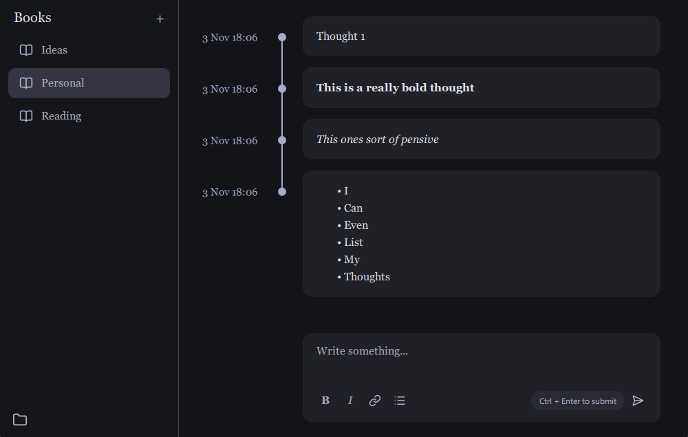

# Rambler

The local journalling app

Rambler is a simple, local-first journalling app built around the idea of capturing your thoughts as they happen. Rather than treating a journal as a collection of polished entries, Rambler lets you see how your thinking develops over time.

I first got the inspiration from *The Social Network*, when Mark Zuckerberg makes Facemash he blogs alongside it. I liked the idea of a record of someone's thoughts as they work through an idea. Rambler takes that concept and makes it private and entirely offline.

## Features
- **Books**: Organise your thoughts into separate books
- **Timeline**: View your entries in chronological order
- **Local Storage**: Your journal stays in your Documents folder and never leaves

## Future Features
Here are some of my future plans:
- Editing entries
- Search across the journal
- Additional formatting such as images and tables
- Themes 
- Custom hotkeys

## Contributing

Rambler is a community project, and contributions are welcome.

Have an idea for a feature? Open an issue and apply the ``feature request`` label.

Found a bug? Please open an issue with steps to reproduce it, and screenshots if relevant.

Want to contribute directly? Feel free to open a pull request. Contributions of all sizes are welcome.

## Privacy

Rambler is designed to be local-first. Your journal is stored locally on your device rather than on a central server.

## Licence

Rambler is open source under the MIT Licence. See LICENSE.txt for details.
